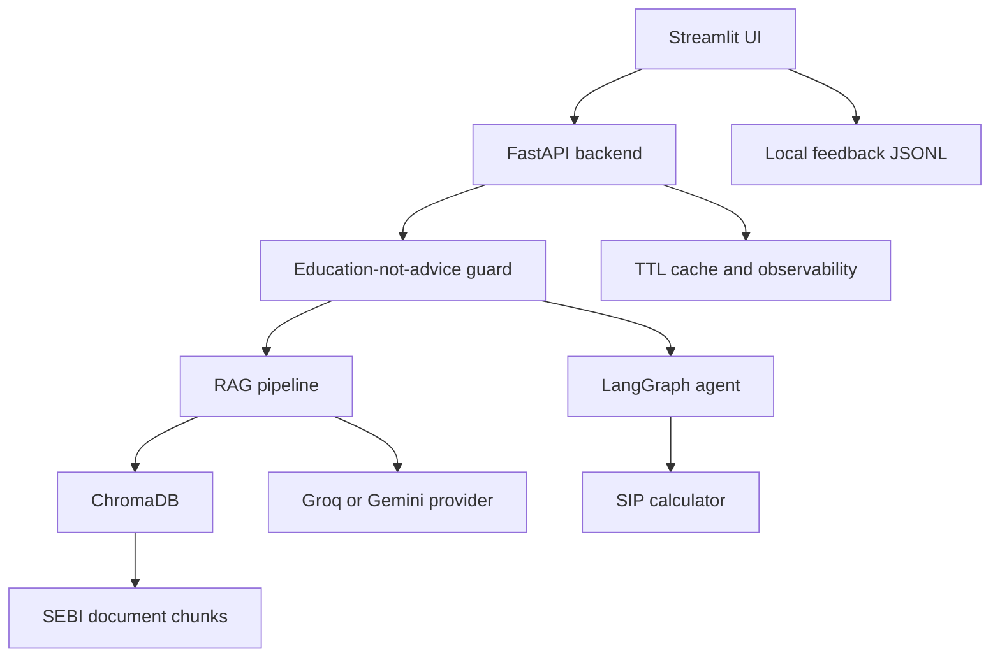
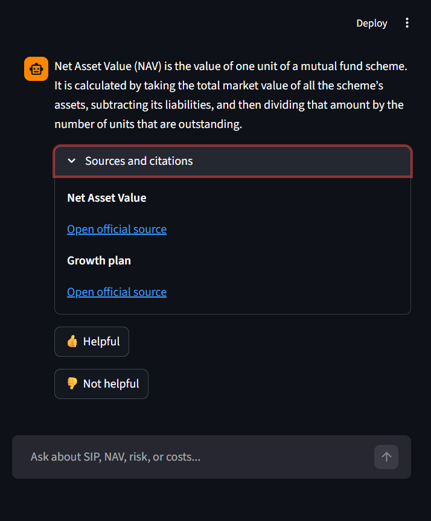
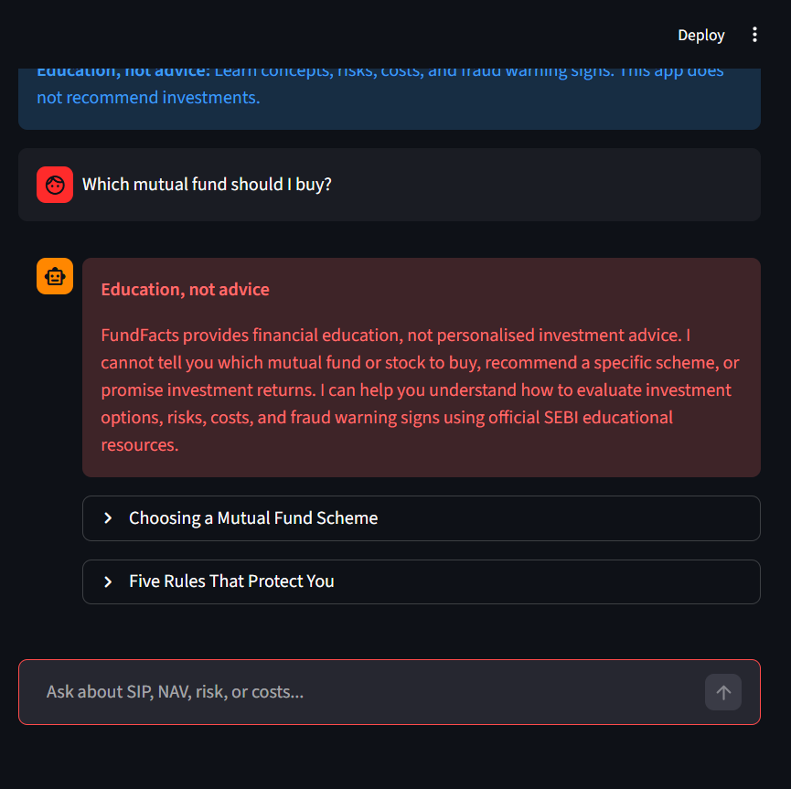

## Project Overview

FundFacts is a SEBI-grounded mutual-fund education assistant. SchemeSaathi
uses retrieval-augmented generation to answer beginner questions from retrieved
SEBI reference chunks and avoids personalised investment recommendations.
The project includes an illustrative SIP calculator, LangGraph agent approval
workflow, FastAPI backend, Streamlit interface, and citation display.

## Problem Statement

Beginners often encounter mutual-fund terminology such as SIP, NAV, expense
ratios, and Riskometer without a simple source-grounded explanation. FundFacts
helps make these concepts understandable while keeping unsupported or
personalised investment advice outside the assistant's scope.

## Solution

SchemeSaathi combines FastAPI, TF-IDF and semantic retrieval, ChromaDB,
SEBI document chunks, an education-not-advice guard, and a provider wrapper
for Groq or Gemini. Users can read grounded educational answers, expand real
source citations, run illustrative SIP calculations with approval, and submit
thumbs-up/down feedback locally.

## Features

- SEBI-grounded RAG answers and citation display.
- Groq/Gemini provider wrapper with structured provider usage metadata.
- SIP NAV-based calculation and assumed-return projection.
- LangGraph conversation memory and explicit SIP approval.
- Deterministic education-not-advice refusal guard.
- In-memory TTL cache for safe repeated `/ask` requests.
- JSON request latency and provider usage logging.
- Streamlit chat interface and local JSON Lines feedback.

## Documentation

- [Interview Preparation](docs/interview.md): 60-second elevator pitch, hardest technical problem (STAR method), and answers to 10 likely technical interview questions.
- [Project Progress](PROGRESS.md): Day-by-day checklist tracking implementation status from Day 1 to Day 14.
- [Resume Highlights](docs/resume.md): Key engineering bullet points for technical resumes and portfolio.

## Architecture



## Demo Video

Demo video: To be added after recording.

# Day 1:
Product: FundFacts is a beginner-friendly mutual fund education platform.

User: College students, beginners and people interested in learning about mutual funds.

Problem: Many beginners don't understand SIP, NAV, risk, KYC and mutual fund terminology.

Data Source: SEBI's official investor education resources and mutual fund investor awareness materials

# Day 2 – Data Structuring & Python CLI

Objective

Create structured mutual fund educational records and build reusable Python functions to manage, search, and retrieve FundFacts data.

Implemented Features

1. Structured Data Creation

Created a UTF-8 JSON collection of structured FundFacts records.

Added 9 topic records covering mutual fund concepts from the SEBI material.

Added 11 glossary-style records covering important mutual fund concepts.

Included definitions and practical examples in simple language.

2. Mutual Fund Concepts Covered

Net Asset Value (NAV)

Total Expense Ratio (TER)

Direct Plan and Regular Plan

SEBI Riskometer – Six risk levels

KYC (Know Your Customer)

Scheme Information Document (SID)

Nomination

Systematic Transfer Plan (STP)

Systematic Withdrawal Plan (SWP)

Exit Load

3. Python Record Management
Implemented reusable functions in app/records.py:

load_records() – Loads records from the data source.

search() – Searches records using keywords.

count_by() – Counts records by category or module.

get_by_id() – Retrieves a specific record using its ID.

4. Command-Line Interface (CLI)

Created an interactive CLI using app/cli.py.

Added menu-driven navigation.

Enabled users to search and explore mutual fund concepts.

Added basic input handling and conditional logic.

5. Project Environment

Created a Python virtual environment (.venv).

Added requirements.txt for dependency management.

Configured .gitignore to exclude unnecessary files.


## Day 3 – SEBI Data Ingestion & Fetching

### Objective
Build the first data-ingestion pipeline for FundFacts using official SEBI investor education resources.

### Data Sources
- [SEBI Investor Education Sitemap](https://investor.sebi.gov.in/ssis/sitemap.html)
- [Investing Through Mutual Funds – Chapter 14](https://investor.sebi.gov.in/ssis/investing-through-mutual-funds-01.html)
- [Investing Through Mutual Funds – Chapter 15](https://investor.sebi.gov.in/ssis/investing-through-mutual-funds-02.html)
- [Investing Through Mutual Funds – Chapter 16](https://investor.sebi.gov.in/ssis/investing-through-mutual-funds-03.html)
- [Five Rules That Protect You](https://investor.sebi.gov.in/ssis/investing-through-mutual-funds-04.html)

### Implemented Features
- Downloaded SEBI HTML documents using Python `requests`.
- Added timeout and HTTP error handling.
- Stored raw HTML documents in `data/raw/`.
- Implemented HTML cleaning and heading-associated definition extraction using BeautifulSoup.
- Extracted multiple distinct concepts from each educational page instead of one chapter record per page.
- Skipped headings without reliable explanatory content and removed duplicate concepts.
- Added a `Record` dataclass to maintain a consistent data structure.
- Added exception handling to skip problematic records.
- Exported 44 cleaned records into `data/records.json`.

### Record Structure
Each processed record contains:

- `concept`
- `plain_definition`
- `example`
- `module_chapter`
- `risk_warning`
- `source_url`

### Files Added
- `app/models.py`
- `app/fetch.py`
- `app/ingest.py`
- `data/raw/`
- `data/records.json`
- `data/raw/manifest.json`

### How to Run
```bash
python -m app.fetch
python -m app.ingest
```

**Output:** Downloaded SEBI source documents and structured JSON records for the FundFacts knowledge base.

## Day 4 – FastAPI, Data Analysis & Smart Search

Day 4 adds a retrieval-based FastAPI service, pandas dataset exploration, and
TF-IDF/cosine-similarity search over the canonical `data/sample_records.json`
dataset. The Day 3 output at `data/records.json` is generated independently
from the downloaded SEBI HTML documents.

### FastAPI endpoints

- `GET /health` checks API availability.
- `GET /records?limit=10` returns up to the requested number of sample records.
- `GET /records/{id}` retrieves one sample record, or returns HTTP 404.
- `GET /search?q=NAV` ranks relevant records with smart search.
- `POST /questions` accepts `{"question": "..."}` and returns matching records.

The question endpoint retrieves source records only; it does not generate an
AI answer or require an external API key. Interactive API documentation is
available at `http://127.0.0.1:8000/docs`.

### Analysis and project structure

`analysis/explore.py` uses pandas to report total records, category
distribution, and records needing content review. `app/smart_search.py`
combines concept, definition, example, chapter, and risk-warning fields,
vectorizes them with TF-IDF, and ranks matches using cosine similarity.

```text
app/
  cli.py
  fetch.py
  ingest.py
  main.py
  models.py
  records.py
  smart_search.py
analysis/
  explore.py
data/
  sample_records.json
  records.json
  raw/
```

### Install and run

```bash
pip install -r requirements.txt
uvicorn app.main:app --reload
python -m analysis.explore
```

### Example API requests

```bash
curl http://127.0.0.1:8000/health
curl "http://127.0.0.1:8000/records?limit=5"
curl http://127.0.0.1:8000/records/G01
curl "http://127.0.0.1:8000/search?q=NAV"
curl -X POST http://127.0.0.1:8000/questions \
  -H "Content-Type: application/json" \
  -d "{\"question\":\"What is NAV in mutual funds?\"}"
```

The analysis command prints the total record count, category distribution,
and the number of records containing missing or placeholder content.

## Day 5 – LLM Basics and Checkpoint 1

Day 5 documents how LLMs work, adds beginner questions for the FundFacts
dataset, and explains the existing TF-IDF search implementation.

- [How LLMs work](docs/how_llms_work.md) explains LLMs, tokenization, training,
  inference, hallucinations, and responsible use. It includes one Mermaid
  flowchart.
- [Beginner user questions](docs/user_questions.md) contains exactly 10
  realistic questions. Question 6 is explicitly unsupported because the
  dataset cannot predict or guarantee future returns.
- [Checkpoint 1 report](docs/checkpoint1.md) explains the real
  `smart_search()` function and records the FastAPI verification results.

Start the FastAPI service with:

```bash
uvicorn app.main:app --reload
```

Open the automatically generated API documentation at
`http://127.0.0.1:8000/docs`.

## Day 6 – Gemini Integration and Prompt Engineering

Day 6 adds **SchemeSaathi**, the Gemini-backed educational assistant inside
FundFacts. It uses structured SEBI records as reference material and does not
provide personalised financial advice, recommend specific schemes, or
guarantee returns.

### Gemini setup

Install the dependencies:

```bash
pip install -r requirements.txt
```

Open `.env` and manually enter your own key:

```text
GEMINI_API_KEY=PASTE_YOUR_OWN_KEY_HERE
```

`.env` is ignored by Git. The safe template is [.env.example](.env.example).
The provider wrapper in [app/llm.py](app/llm.py) loads the key from the
environment, uses the Gemini `v1beta` API for JSON mode, and creates the
Gemini client only for a request. The default model is
`gemini-3.5-flash-lite` and can be overridden with `GEMINI_MODEL`. Provider
configuration and availability failures are converted into safe API errors.

### Prompts and chat

- [system_prompt.txt](prompts/system_prompt.txt) defines SchemeSaathi's
  educational and safety rules.
- [task_prompt_v1.txt](prompts/task_prompt_v1.txt) is the baseline task prompt.
- [task_prompt_v2.txt](prompts/task_prompt_v2.txt) grounds answers in retrieved
  FundFacts records and requires uncertainty to be acknowledged.

`POST /chat` accepts `{"message": "What is NAV?"}` and returns:

```json
{
  "answer": "Educational answer",
  "confidence": "high",
  "follow_up": "A useful follow-up question?"
}
```

The confidence value is limited to `high`, `medium`, or `low`. The endpoint
retrieves records with the existing TF-IDF search, loads the trusted system
prompt and task prompt v2, then validates Gemini's JSON response with Pydantic.

### Prompt evaluation

[prompt_compare.md](eval/prompt_compare.md) compares v1 and v2 using the same
ten Day 5 questions. Question 6 is important because it tests whether the
assistant refuses to invent a guaranteed future return or specific-fund
recommendation. Run the repeatable comparison with:

```bash
python eval/compare_prompts.py
```

Without a configured key, the evaluation remains **Pending – Gemini API key
required** and does not fabricate responses or scores. With a key, provider
responses are saved locally for human review; the script does not generate
qualitative scores automatically.

Start and test the service with:

```bash
uvicorn app.main:app --reload
```

Then open `http://127.0.0.1:8000/docs` and try `POST /chat`. Opening
`GET /chat` directly returns usage instructions; send a JSON body for an AI
response.

## Day 7 – Semantic Search and ChromaDB

Day 7 adds local document chunking, Sentence Transformers embeddings, and a
persistent ChromaDB index. Chunking keeps meaningful sentence groups while
preserving each source URL, title, page value, and available record ID.
Embeddings are numerical representations of text; the local
`sentence-transformers/all-MiniLM-L6-v2` model is used for both indexing and
queries. The model may download once during initial setup.

ChromaDB stores the vectors and metadata in `data/chroma_db/`, so the index
persists across application restarts. Semantic search finds meaning-related
text, while the existing `/search` route remains a TF-IDF keyword-based
search. Semantic search does not require the Gemini API key.

Install dependencies and build the index:

```bash
pip install -r requirements.txt
python -m app.vectorstore
```

Start the API:

```bash
uvicorn app.main:app --reload
```

Test `GET /search/semantic?q=What is NAV` at
`http://127.0.0.1:8000/docs`. Evaluate the exact ten Day 5 questions with:

```bash
python -m eval.evaluate_search
```

The generated [search evaluation](eval/search_results.md) records actual
retrieved chunks and scores when the local model and collection are available.
Relevance judgments remain subject to manual review, and Question 6 cannot be
answered by semantic retrieval because it asks for a guaranteed future return.

## Day 8 – RAG and Evaluation

Day 8 adds Retrieval-Augmented Generation (RAG) through
[app/rag.py](app/rag.py). The pipeline retrieves actual SEBI chunks from
ChromaDB, checks evidence and safety constraints, then asks the configured LLM
provider to generate
a beginner-friendly answer grounded only in those chunks. Responses include
the retrieved chunk IDs, titles, URLs, and page values as citations.

If the evidence is insufficient, or a question asks for a guaranteed return,
personalised advice, or a specific scheme recommendation, SchemeSaathi returns
the exact answer **“I don't know”** rather than using unsupported general
knowledge. Question 6 from Day 5 is the primary abstention case.

The 15-case evaluation set is in [eval_set.json](eval/eval_set.json). It
preserves the ten Day 5 questions and adds five concept, paraphrase, risk, and
unsupported scenarios. [run_eval.py](eval/run_eval.py) compares two genuinely
separate persistent Chroma collections:

- Configuration A: 400-character chunks, top-k 3
- Configuration B: 800-character chunks, top-k 5

Run the evaluation with:

```bash
python -m eval.run_eval
```

The script records provider outputs, citations, retrieval metadata, abstention
checks, and latency in `eval/rag_results.json`. Factual correctness and source
relevance require human review. The comparison summary is
`eval/rag_comparison.md`; no winner is declared when results are incomplete or
inconclusive. Configure the selected provider in the local `.env`; keys are
never stored in evaluation output.

### Day 8 evaluation status

Evaluation date: **2026-11-16**. Both indexes were built independently and all
30 provider evaluation slots completed with Groq
(`openai/gpt-oss-20b`).

| Metric | Config A (400 chars, k=3) | Config B (800 chars, k=5) |
|---|---|---|
| Answerability accuracy | 9/15 | 10/15 |
| Unsupported-question abstention | 2/2 | 2/2 |
| Citation validity (automated) | 5/15 | 5/15 |
| Source relevance (automated URL match) | 7/13 | 8/13 |
| Response format validity | 15/15 | 15/15 |
| Average latency | 1.375s | 6.517s |
| Overall winner | Configuration B | Configuration B |

The automated winner is **Configuration B** under the rule that prioritizes
answerability, citation validity, source relevance, and response format, with
lower latency as the tie-breaker. Factual correctness still requires human
review.

## Day 9 Agent Tools and LangGraph

The agent feature adds two bounded workflows while preserving the existing
`/ask`, `/chat`, and semantic-search endpoints:

- The hand-written agent in `app/agent_loop.py` transparently routes an
  educational question to the existing RAG pipeline, a calculation request to
  the deterministic SIP tool, or a combined request to both.
- The LangGraph workflow in `app/graph.py` uses typed state, conditional
  routing, one approval interrupt, and a SQLite-backed checkpointer.

### SIP rupee-cost averaging tool

`app/tools.py` supports two calculation modes:

1. **NAV-based calculation:** provide a positive monthly SIP and a list of
   monthly NAVs. It calculates monthly units, total investment, accumulated
   units, weighted average cost, final value at the last NAV, and gain or loss.
2. **Assumed-return projection:** provide a monthly SIP, annual return
   assumption, number of years, and optionally a yearly step-up percentage.
   The annual return is converted to an effective monthly rate. Contributions
   occur at the **end of each month**, and the monthly schedule reports the
   projected balance. This is illustrative: it does not claim historical NAVs
   or actual units.

Inputs are validated in deterministic Python using `Decimal`; no LLM performs
arithmetic. Calculations are educational illustrations, not investment advice.

The official SEBI worked example was verified at
[SEBI Module 4 Chapter 16](https://investor.sebi.gov.in/ssis/investing-through-mutual-funds-03.html):
₹6,000 invested at NAVs ₹60, ₹50, ₹40, and ₹60 buys 100, 120, 150, and 100
units. The result is ₹24,000 invested, 470 units, an average cost of ₹51.06,
and a final value of ₹28,200.

### Conversation memory and approval

Each LangGraph request uses a caller-supplied `thread_id`. The SQLite
checkpointer keeps threads separate and preserves a pending approval so the
same thread can resume. This local persistence has been tested during the
current run; it should not be treated as a cross-deployment memory service.

SIP calculations require one human approval because they are illustrative
financial calculations. The graph never runs the calculator before approval.
Rejection returns a cancellation response, and repeated approval after
completion is rejected because there is no longer a pending approval.

### `POST /agent`

Install dependencies and start the API:

```bash
pip install -r requirements.txt
uvicorn app.main:app --reload
```

Open the interactive API documentation at
`http://127.0.0.1:8000/docs`.

Start a calculation:

```bash
curl -X POST http://127.0.0.1:8000/agent \
  -H "Content-Type: application/json" \
  -d "{\"thread_id\":\"demo-session-1\",\"message\":\"Calculate a monthly SIP of 1000 with NAVs 10, 8, 12, 10\"}"
```

The response is `approval_required` and shows the proposed inputs. Resume the
same thread only after reviewing them:

```bash
curl -X POST http://127.0.0.1:8000/agent \
  -H "Content-Type: application/json" \
  -d "{\"thread_id\":\"demo-session-1\",\"approved\":true}"
```

Use `"approved": false` to cancel. Approval requests with an unknown or
already-completed thread are rejected. Educational questions do not require
approval and return the normal RAG answer with genuine source citations.

## Day 10 – Streamlit UI and Checkpoint 2

The Streamlit interface in [ui/app.py](ui/app.py) provides a beginner-friendly
FundFacts chat surface for SchemeSaathi. It calls the existing `/ask` endpoint
for ordinary educational questions and `/agent` for SIP calculations requiring
thread memory and human approval. Returned citations are displayed in an
expandable **Sources and citations** section.

The UI preserves chat history in Streamlit session state and stores replaceable
thumbs-up/down feedback as UTF-8 JSON Lines in `data/feedback.jsonl`. This
personal feedback file is ignored by Git and contains no API keys.

### Education, not advice

Recommendation requests are blocked by a deterministic shared guard before any
LLM call. The fixed refusal card explains that FundFacts provides education, not
personalised investment advice. It links to two verified SEBI resources:

- [Choosing a Mutual Fund Scheme](https://investor.sebi.gov.in/ssis/investing-through-mutual-funds-02.html)
- [Five Rules That Protect You](https://investor.sebi.gov.in/ssis/investing-through-mutual-funds-04.html)

The second resource displays a checklist covering guaranteed-return claims,
verification before payment, sensitive credentials, urgency, and rapid
reporting. The same guard is enforced at the FastAPI `/ask` and `/agent`
boundaries, so direct API calls cannot bypass it.

### Run the Checkpoint 2 demo

```bash
pip install -r requirements.txt
uvicorn app.main:app --reload
```

In another terminal:

```bash
streamlit run ui/app.py
```

- Backend: `http://127.0.0.1:8000/docs`
- Streamlit: `http://localhost:8501`

The short trainer walkthrough is in
[docs/checkpoint2_demo.md](docs/checkpoint2_demo.md). Verify the live UI and
capture the required screenshot manually before creating the `checkpoint-2`
tag.



The deterministic refusal card was also captured during the live UI check:



[](https://github.com/GauravN2005/Gen-AI-Examate-Batch/actions/workflows/ci.yml)

## Day 11 - CI/CD and Live Deployment

Day 11 adds:

- GitHub Actions Ruff, pytest, and Docker-build checks.
- A FastAPI production Docker image.
- A separate Streamlit Docker image.
- Local and hosted deployment documentation.

Deployment status is not yet verified:

| Item | Status |
|---|---|
| CI workflow | Prepared locally; GitHub run not yet verified |
| Pull request | Not created by this local preparation |
| Pull request merge | Not merged |
| Hosting platform | Render, pending manual setup |
| Backend live URL | `NOT_DEPLOYED` |
| Streamlit live URL | `NOT_DEPLOYED` |
| Public `/health` URL | `NOT_DEPLOYED` |
| Public `/health` status | Not verified |

The actual public backend URL must replace `NOT_DEPLOYED` only after manual
deployment and verification. Instructions are in
[docs/day11_deployment.md](docs/day11_deployment.md), and the manual PR process
is in [docs/day11_pr_instructions.md](docs/day11_pr_instructions.md).

## Day 12 – CI/CD and Live Deployment

[](https://github.com/GauravN2005/Gen-AI-Examate-Batch/actions/workflows/ci.yml)

Day 12 reuses and completes the existing GitHub Actions, Docker, FastAPI, and
Streamlit deployment preparation.

| Item | Status |
|---|---|
| Ruff | Passed locally |
| Pytest | Passed locally |
| Docker build | Docker CLI found; daemon unavailable locally |
| GitHub Actions | Prepared; real run not verified |
| PR URL | `NOT_PROVIDED` |
| PR merge status | Not merged |
| Deployment platform | Render, pending manual setup |
| Public backend URL | `NOT_DEPLOYED` |
| Public frontend URL | `NOT_DEPLOYED` |
| Public `/health` URL | `NOT_DEPLOYED` |
| Public `/health` status | Not verified |

Manual PR and live-deployment evidence is documented in
[docs/day12_fix_guide.md](docs/day12_fix_guide.md). Replace `NOT_DEPLOYED`,
`NOT_PROVIDED`, and `Not merged` only after GitHub and Render provide verified
results.

Manual processes are documented in
[docs/day12_pr_guide.md](docs/day12_pr_guide.md) and
[docs/day12_deployment.md](docs/day12_deployment.md). The exact tracker text is
in [docs/day12_assignment_tracker.txt](docs/day12_assignment_tracker.txt).

## Production notes

Production request handling includes structured JSON logs for request ID,
endpoint, HTTP status, elapsed milliseconds, cache state, provider/model,
and provider token fields when available. API keys and full user questions or
answers are not logged by default.

Safe, cacheable `/ask` responses use an in-memory TTL cache. The default TTL
is 300 seconds and the default maximum size is 128 entries. Cache entries are
per process and cleared on restart. Pending approvals and SIP actions are not
cached, provider errors are not cached, and the cache key includes normalized
input, top-k, collection, provider, model, prompt version, and a knowledge-base
hash.

The configured input limit is 2,000 characters. Agent NAV lists are limited to
1,200 values. Oversized or blank inputs are rejected instead of silently
truncated. Cached `/ask` results retain their original citations and are
invalidated by a knowledge-base hash or cache TTL.

The prompt-injection test uses controlled retrieved text containing malicious
instructions and verifies that RAG treats retrieved documents as untrusted
reference data and that the education guard remains effective. It is a mocked
structural test, not a complete live adversarial-security claim.

The benchmark script in [eval/production_benchmark.py](eval/production_benchmark.py)
ran 20 mocked local `TestClient` requests against repeated educational questions.
It did not make live Groq or Gemini calls.

| Metric | Measured result |
|---|---:|
| Requests tested | 20 |
| Average latency | 9.944 ms |
| Median latency | 7.841 ms |
| P95 latency | 10.480 ms |
| Cache hit rate | 80.0% |
| Cache miss rate | 20.0% |
| Average input tokens | unavailable |
| Average output tokens | unavailable |
| Input length limit | 2,000 characters |
| Prompt-injection test | Passed in mocked structural test |
| Live benchmark status | Incomplete / not run |

## Results

| Result | Measured or current status |
|---|---|
| RAG evaluation questions | 15 cases for each configuration |
| RAG winner | Configuration B; 10/15 answerability accuracy |
| Unsupported-question abstention | 2/2 for both configurations |
| Citation validity | 5/15 for both configurations |
| Source relevance | 7/13 for Configuration A; 8/13 for Configuration B |
| CI status | Prepared; real GitHub run status pending |
| Mock production benchmark | 20 requests; 9.944 ms average; 80.0% hit rate |
| Prompt-injection test | Passed in mocked structural testing |
| Public deployment | Not verified |

The existing genuine RAG metrics are in
[eval/rag_comparison.md](eval/rag_comparison.md). Production benchmark data is in
[eval/production_results.json](eval/production_results.json).