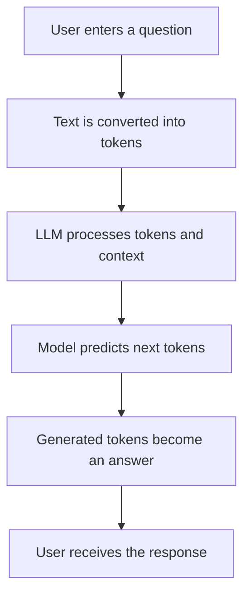

# How Large Language Models (LLMs) Work – FundFacts

## What is an LLM?

A Large Language Model (LLM) is a computer program trained to recognize
patterns in a very large collection of text. During training, it sees examples
of how words and ideas appear together. When a user enters a question, the
model uses those learned patterns and the words in the question to generate a
response.

An LLM is not automatically a fact checker. It can produce a sentence that
sounds confident even when the sentence is wrong or unsupported. This is like
an autocomplete tool finishing a sentence in a believable way without
understanding whether the claim is true.

## How Does an LLM Work?

1. **User enters a question.** For example, a user asks what NAV means.
2. **The question is broken into tokens.** Tokens are small pieces of text,
   such as words, parts of words, or punctuation.
3. **Tokens are processed by the model.** The model looks at the tokens and
   their order.
4. **The model predicts the next token.** It uses learned patterns and the
   available context to estimate what text should come next.
5. **Tokens are generated sequentially.** The model adds one token, then uses
   the expanded context to choose the next one.
6. **The tokens become a readable response.** The generated pieces are joined
   and displayed as normal text.

## LLM Training vs Inference

**Training** is the learning stage. The model processes large datasets and
adjusts its internal parameters so it becomes better at recognizing language
patterns.

**Inference** is the use stage. The trained model receives a new prompt and
generates a response using what it learned. For example, reading many examples
of questions and answers is training; answering a new question about SIP is
inference.

## What Are Hallucinations?

An LLM hallucination is an incorrect or unsupported statement that sounds
convincing. For example, an AI might invent a claim that a particular mutual
fund will provide a guaranteed return next month. That claim would be unsafe
because market-linked investments do not guarantee future returns, and
financial learners could make decisions based on the invented information.

## How LLMs Relate to FundFacts

FundFacts currently uses structured educational records based on official SEBI
investor-education material. Its current search feature uses TF-IDF and
cosine similarity to rank matching records. TF-IDF is a text-search technique,
not an LLM.

The FastAPI backend provides access to the records and the search results. A
future version could use retrieval-augmented generation (RAG): first retrieve
relevant SEBI records, then give those records to an LLM as context for an
answer. Any future generated answer should still be checked against the
official source material.

## Limitations and Responsible Use

- LLMs can make factual mistakes.
- Their responses can be outdated.
- Important claims should be checked against reliable, current sources.
- FundFacts must not provide personalized investment advice.
- FundFacts should not recommend which mutual fund to buy.

